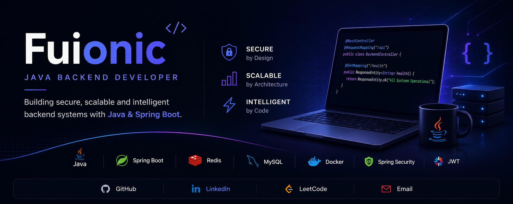

  

<h3 align="center">
Building Secure • Scalable • Intelligent Backend Systems
</h3>

## 👋 About

- 💻 Java Backend Developer passionate about building production-ready applications
- 🚀 Experienced with Spring Boot, Spring Security, Redis, MySQL & Docker
- 🌱 Currently learning Linux, Docker & Unit Testing

---

# 🚀 Featured Projects

## 🤖 GitHub Analyzer

> AI-powered GitHub Profile Analyzer that generates developer summaries and recommends software engineering roles using Google Gemini.

### ✨ Highlights
| | |
|:---|:---|
|  JWT Authentication | Layered Architecture |
|  Google & GitHub OAuth2 |  DTO Pattern |
|  Redis Caching |  Bean Validation |
|  Dockerized Deployment |  Global Exception Handling |

**Tech**

`Java` `Spring Boot` `Spring Security`
`Redis` `MySQL`
`Docker`
`JWT`
`OAuth2`
`Gemini AI`

---

## 🔐 SubGuard

> Privacy-first Subscription & Account Management Platform.

**Highlights**

- Spring Security
- JWT Authentication
- Subscription Tracking
- Notification Service
- Privacy Vault

**Tech**

`Java`
`Spring Boot`
`Spring Security`
`MySQL`
`JWT`

---

# 🛠 Tech Stack

---
